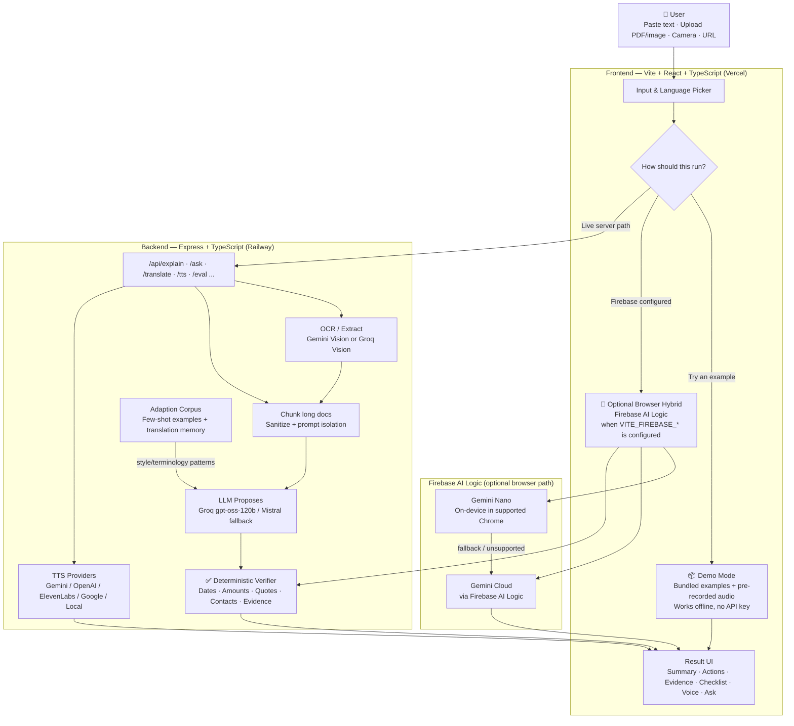

# AccessBridge

**Ctrl+V for confusing paperwork.** Paste or snap any official document — a government notice, medical form, school fee letter, scholarship, or financial document — and get a plain-language explanation, a step-by-step checklist, and a voice readout in your own language.

**Live:** https://access-bridge-brown.vercel.app/

> If a document decides your access to healthcare, money, or services, you should be able to understand it in your own language in 10 seconds.

---

## How to test (30 seconds)

**Live site:** https://access-bridge-brown.vercel.app/

1. Open the site on a phone or desktop.
2. Click **Try an example** (or paste your own text).
3. Pick a language: **English · አማርኛ · Afaan Oromoo · ትግርኛ**.
4. Press **Explain it**.
5. Read the plain-language summary, action checklist, deadlines, costs, and documents to bring.
6. Press **Listen** for the voice readout.
7. Ask a follow-up question like *"What happens if I miss the deadline?"*

**Demo mode works offline with no API key** — the bundled examples never stall.

### Run locally

```bash
npm install
npm run dev
# Frontend: http://localhost:5174/
# API proxy target: http://localhost:3001/ (server started by npm run dev)
```

Useful checks:

```bash
npm test          # unit tests
npm run typecheck # frontend + server typecheck
npm run smoke     # demo/build/route smoke checks
```

---

## What AccessBridge does

AccessBridge is built for people who receive important documents they cannot easily read — because of language, literacy, jargon, bad formatting, or stress.

| You give it | AccessBridge gives back |
|---|---|
| Pasted text, TXT/PDF/image upload, camera photo, or public web page URL | Extracted document text |
| A language choice | Plain-language explanation in that language |
| The original document | **Verified** deadlines and costs, with evidence traced to the source |
| The explanation | Action checklist, eligibility, how to apply, documents to bring, glossary, contacts, warnings |
| A tap on Listen | Voice readout (recorded demo audio, server TTS, or browser speech fallback) |
| A follow-up question | An answer grounded in the document, or a clear "not in the document" response |

### Supported languages

| Language | Status | Notes |
|---|---|---|
| English | Source | Primary document/source language |
| Amharic (አማርኛ) | Measured | Evaluated on `/eval` |
| Afaan Oromoo | Measured | Evaluated on `/eval` |
| Tigrinya (ትግርኛ) | Measured | Evaluated on `/eval` |
| Kiswahili | Experimental | Supported, not yet scored |
| Arabic (العربية) | Experimental | RTL rendering, not yet scored |
| French | Experimental | Supported, not yet scored |

---

## Architecture — one clear diagram

> Hackathon tip: *one clear diagram of your architecture beats three paragraphs explaining it.*



### Read the diagram in 20 seconds

1. **User enters a document** — paste, upload, camera, or URL.
2. **Frontend chooses a path**:
   - **Demo mode** uses bundled local data and works offline.
   - **Optional browser hybrid** uses Firebase AI Logic when configured (on-device Gemini Nano when available, cloud Gemini fallback).
   - **Live server path** sends the request to the Express API on Railway.
3. **The model proposes, code verifies**. The LLM drafts the explanation; deterministic code re-finds every date, amount, quote, and contact in the original source before marking it verified.
4. **Adaption is load-bearing**. The Adaption-translated corpus provides few-shot examples and translation-memory patterns to improve low-resource language output.
5. **The UI shows evidence, not just answers**. Users see the explanation, action checklist, verified/unverified badges, original source, voice readout, and can ask follow-up questions.

---

## How it works (step by step)

### 1) Input

The user can paste text, upload a `.txt`, `.pdf`, `.png`, `.jpg`, or `.webp`, take a camera photo, or import a public web page URL.

- Text-like files are read directly.
- Images and scanned PDFs go through OCR.
- URL import fetches a public page server-side and strips it to readable text.
- The original upload/text is kept visible so the user can compare the explanation against the source.

### 2) Document preparation

- The text is sanitized and length-limited.
- Long documents are **chunked** instead of silently truncated.
- The prompt wraps document content in isolation markers so instructions inside the document are treated as content, not commands.

### 3) Explanation generation

The LLM produces a structured JSON explanation:

- what the document is,
- what the user must do,
- who can apply / how to apply,
- deadlines and costs,
- documents to bring,
- glossary, contacts, examples, sections, warnings.

For low-resource languages, Adaption-translated examples and retrieved translation-memory pairs are added as **style/terminology patterns** — never as facts about the user's document.

### 4) Deterministic verification (the trust boundary)

**The model proposes; deterministic code verifies.**

Before a deadline or cost is shown as verified, the verifier checks it against the original source text:

- Normalizes whitespace, Unicode direction marks, date separators, and Ge’ez numerals.
- Finds dates in ISO, numeric, month-name, and day-first formats.
- Finds amounts in ETB, USD, EUR, GBP.
- Requires the matched evidence to be locatable in the original source.
- Fails closed: no traceable evidence = **not verified**.
- Recomputes confidence from verification results; the model cannot upgrade confidence.

Glossary entries and contact details are also checked for traceability. Untraceable claims are dropped or downgraded.

### 5) User experience

The result screen gives the user:

- **Plain-language summary**
- **Action checklist** with progress tracking
- **Deadline & cost cards** with verified/check-original badges
- **Evidence highlights** in the original document
- **Listen** button for voice readout
- **Ask** box for grounded follow-up questions
- **Translate / Simplify / Compare / Opportunity check** in the workspace

---

## Core trust model

| Rule | Why it matters |
|---|---|
| LLM proposes, code verifies | Models can hallucinate dates/amounts; users need trustworthy facts |
| No verified badge without source evidence | Prevents fake confidence |
| OCR is not ground truth | Scanned text can be wrong; original stays visible |
| Processing failures are errors, not fake success | Avoids silent misinformation |
| Demo fallback only for demo content | Live failures are reported honestly |
| Adaption examples are patterns, not facts | Prevents copying dataset dates/names into user docs |

---

## Features

### Core

- Paste/upload/photo/URL input
- Structured explanation: summary, actions, eligibility, how to apply, deadlines, costs, documents to bring
- Language switcher: English, Amharic, Afaan Oromoo, Tigrinya + experimental languages
- Voice readout with recorded demo audio / server TTS / browser fallback
- Follow-up questions grounded in the document
- Demo mode with 4 preloaded documents in 4 languages

### Workspace

- **Upload wizard** — Upload → Explain → Verify → Listen → Ask → Evaluate
- **Document Reader** — original/extracted text next to explanation
- **Library** — saved documents and categories, browser-local
- **Assistant** — ask questions across one or more saved documents
- **Translate** — side-by-side document/paragraph/sentence translation
- **Simplify** — rewrite at simple/standard/detailed level
- **Voice Studio** — speed, summary/full text, translated readout
- **Action Center** — tick-off checklist, downloadable checklist
- **Opportunity Check** — compare your details against published criteria
- **Compare** — see what changed between two documents
- **History** — saved conversations with summaries
- **Settings** — language, accessibility, profile, delete local data
- **Eval** — measured baseline vs Adaption-improved results

### Accessibility

- Light/dark theme
- Font size, contrast, spacing, reduced motion, density, simple mode
- Keyboard navigation and visible focus
- Screen-reader labels and large touch targets
- Mobile-first responsive layout
- PWA shell with cached app assets and demo audio

---

## How we use Adaption (load-bearing)

Adaption is not a logo on the README — it is used in the product pipeline.

1. **Dataset build** — 25 authored seed documents are adapted/translated through Adaption into a multilingual corpus (`data/adaption/dataset.json`, 99 rows).
2. **Few-shot examples** — `server/lib/services/adaption.service.ts` selects language-relevant Adaption examples and injects them into explanation prompts as style/pattern guidance.
3. **Translation memory** — `server/lib/services/adaption-memory.service.ts` retrieves similar Adaption source/translation pairs by local cosine similarity and adds them to translation prompts as terminology guidance.
4. **Evaluation** — `/eval` compares baseline vs Adaption-adapted outputs on held-out seeds and publishes failures honestly.

OCR and speech are independent providers and are reported as independent on the eval page.

---

## Evaluation

The eval harness compares **baseline** vs **Adaption-adapted** explanations on held-out seeds.

- Held-out seeds are excluded from few-shot examples.
- Metrics are deterministic where possible: schema validity, date/amount recovery, verification rate, hallucinated/unverified fields, script/language correctness.
- Provider errors are counted as **not measured**, not as wins.
- Failure cases are published.

Current measured snapshot (`data/eval/results.json`, generated 2026-11-08, model `openai/gpt-oss-120b`):

| Language | Baseline date / amount | Adapted date / amount | Adapted measured rows | Notes |
|---|---:|---:|---:|---|
| Amharic | 38.9% / 34.6% | 100% / 100% | 9/18 | 9 provider/rate-limit errors reported as not measured |
| Afaan Oromoo | 27.8% / 23.1% | 100% / 92.3% | 18/18 | Full coverage |
| Tigrinya | 25.0% / 36.4% | 100% / 100% | 7/18 | 11 provider/rate-limit errors reported as not measured |

The eval page also publishes 38 failure rows. This is intentional: judges should see where the system fails, not only polished wins.

---

## Privacy

- **Documents are not stored on the server.** They are processed in memory.
- **Server logs** contain metadata (request ID, latency, outcome, verification counts), not document text or secrets.
- **Browser storage** keeps your library, checklist progress, translation history, and preferences locally on your device.
- **Accounts are optional.** If used, the server stores name, password hash, and session records — not document text.
- **Live processing** may send document content to configured external AI providers (LLM/OCR/TTS), as disclosed in the app.
- **Demo mode** works without live provider calls.

---

## Deploy

The deployment is split:

- **Frontend** — Vite static build on Vercel.
- **Backend** — Express API on Railway.

### Frontend (Vercel)

Set **Root Directory = `frontend`**.

| Setting | Value |
|---|---|
| Install | `npm install` |
| Build | `npm run build` |
| Output | `dist` |

Environment variable:

```bash
VITE_API_BASE=https://your-railway-service.up.railway.app
```

`VITE_API_BASE` is baked in at build time — **redeploy after changing it**.

### Backend (Railway)

Start command:

```bash
npm run start
```

Key environment variables:

```bash
NODE_ENV=production
CORS_ORIGINS=https://access-bridge-brown.vercel.app
GROQ_API_KEY=...
MISTRAL_API_KEY=...
GEMINI_API_KEY=...
ADAPTION_API_KEY=...
ADAPTION_BASE_URL=https://api.prod.adaptionlabs.ai
DAILY_SPEND_CAP_USD=5
# Optional: TTS_PROVIDER, TTS_PROVIDER_KEY, TTS_BASE_URL, AUTH_STORE_PATH, COOKIE_SAMESITE
```

Verify:

```bash
curl https://your-railway-service.up.railway.app/api/health
# {"ok":true}
```

If the frontend cannot reach the API:

1. Check `/api/health` on Railway.
2. Check browser Network tab — `404` usually means `VITE_API_BASE` was missing at build time.
3. CORS error means `CORS_ORIGINS` does not include the exact Vercel origin.

See [`DEPLOY.md`](./DEPLOY.md) for the full deployment guide.

---

## Limitations (honest)

- **Not legal or medical advice.** Always verify important actions with the issuing organization.
- **Low-resource language quality varies.** Amharic/Oromo/Tigrinya are measured; Swahili/Arabic/French are experimental.
- **OCR can fail** on handwriting, blur, glare, or low-resolution photos. Pasted text is most reliable.
- **Model prose is not the same as verified fact.** Summaries/actions are generated; dates/amounts/quotes/contacts have deterministic traceability checks.
- **Eligibility check is an assessment, not a decision.** It compares published criteria to what the user says; it cannot guarantee acceptance.
- **URL import** only works for public pages and may miss content behind login/paywalls/JS rendering.
- **Accounts are file-backed by default.** On ephemeral filesystems, set `AUTH_STORE_PATH` to persistent storage or use a DB adapter.
- **Rate limits/spend caps are in-memory per process.** Multi-instance deployment needs shared stores.
- **TTS coverage depends on provider/device.** Demo has recorded EN/AM audio; other cases use server TTS or browser voice.

---

## Future work

- Cross-device sync for library/history
- Push reminders for deadlines
- Offline OCR
- Native mobile app
- Shared rate-limit/spend/auth stores for multi-instance deployment
- Database-backed accounts
- More measured languages and larger eval corpus
- Public accessibility audit/API

---

## Tech stack

- **Frontend:** Vite, React 19, TypeScript, Tailwind CSS 4, Zod, Lucide
- **Backend:** Express 5, TypeScript, Node 22, tsx, multer, pdf-parse, Zod
- **AI/Providers:** Groq, Mistral, Gemini Vision, Gemini/OpenAI/ElevenLabs/local TTS, Adaption
- **Optional:** Firebase AI Logic browser hybrid path (when configured)
- **Testing:** Node test runner, TypeScript typecheck, smoke script, eval harness
- **Deploy:** Vercel (frontend) + Railway (backend)

---

## Repo map

```text
frontend/                 React + Vite app
  src/screens/            Main user flows (Home, Upload, Reader, Assistant, Eval, ...)
  src/components/         UI components
  src/lib/verify.ts       Deterministic verification (shared trust boundary)
  src/lib/hybrid/         Optional Firebase AI Logic browser hybrid
  src/data/demo/          Offline demo documents

server/                   Express API
  routes/                 API endpoints
  lib/services/           Explain/follow-up/translation/speech services
  lib/providers/          LLM/OCR/TTS/Adaption adapters
  lib/verify/             Server-side verification helpers
  lib/security/           Rate limit, spend guard, input/file/url guards

data/
  adaption/               Adaption seeds, dataset, manifest
  eval/                   Measured evaluation results

scripts/                  Smoke, eval, dataset, audio generation
tests/                    Unit/security/regression tests
docs/                     Architecture/privacy/eval docs (evolving)
```

---

## Hackathon note

Built during the **CTRL-V Hackathon**. The repo also contains an evolving **AccessBridge Hybrid** direction (see `AGENTS.md`) toward Firebase AI Logic hybrid inference for #BuildHybridAI; the README above describes the current implemented project and clearly labels optional/experimental paths.

**License:** MIT. See [`LICENSE`](./LICENSE).
